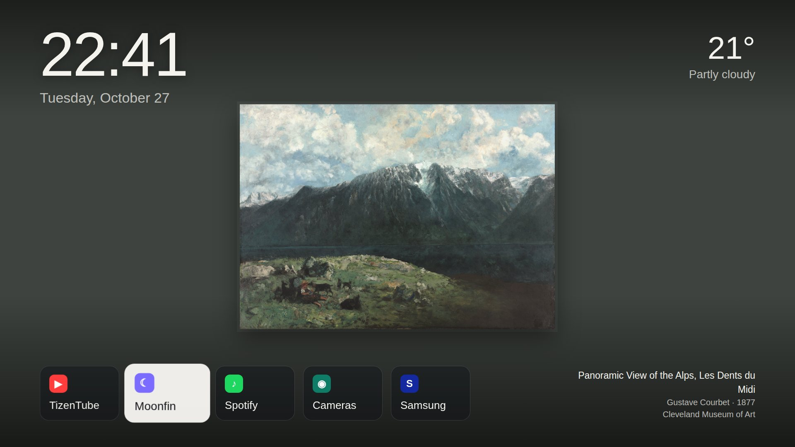
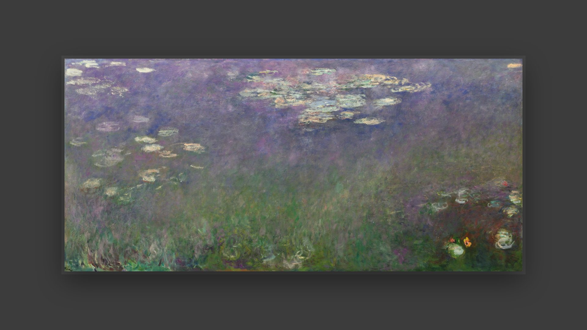
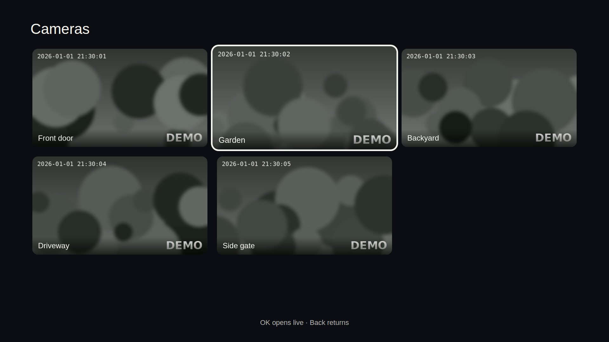
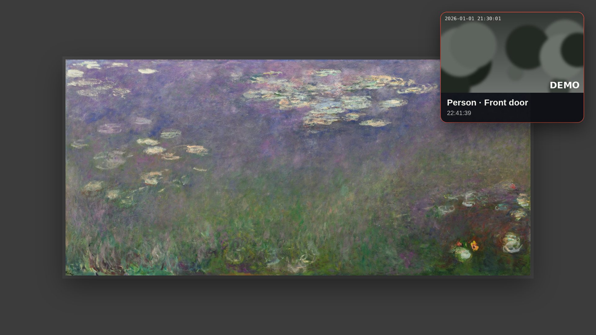

# Art Home — a gallery home screen for Samsung Tizen TVs



**Art Home** turns a Samsung Tizen TV into a quiet picture frame: public-domain paintings fill the
screen, a clock and the weather sit on top, and a small row of apps is one click away. When nobody
touches the remote, the interface fades and only the artwork remains. It also shows your security
cameras and pops up a card when someone walks past one.

> Built on **[AeroTizen](https://github.com/helalaou/AeroTizen)** by Hamza El Alaoui, which makes the
> remote's **Home** button (and power-on) open a custom launcher on Tizen TVs, with a backup and a
> clean way back. Art Home replaces AeroTizen's interface with its own and keeps its Home service
> unchanged. For AeroTizen itself — its launcher, debloat tools and DNS block lists — see the
> [original repository](https://github.com/helalaou/AeroTizen).

| Frame mode | Cameras | Detection pop-up |
|---|---|---|
|  |  |  |

*Screenshots are rendered at 1920×1080 from the demo mode: camera images are synthetic placeholders.
Paintings: Gustave Courbet and Claude Monet, Cleveland Museum of Art, CC0.*

---

## What Art Home adds to AeroTizen

- **An art library that costs nothing.** `curate_art.py` builds a collection from the
  [Cleveland Museum of Art Open Access](https://openaccess-api.clevelandart.org/) API — only works the
  museum dedicates as **CC0** — picks landscape-friendly paintings, resizes them to 2560 px and
  stores their average colour. The TV loads them from your own server, so a flaky internet
  connection never leaves the wall blank. Every artwork is credited on screen (title, artist, year,
  museum), even though CC0 doesn't require it.
- **Matted, never cropped.** A painting that isn't close to 16:9 is shown on a mat in its own average
  colour, like a framed print, instead of being cut to fill the screen.
- **Frame mode.** After 20 seconds without input the clock, weather and apps fade out and the
  artwork steps forward. The first key only wakes the screen; it never triggers an action.
- **Cameras.** A grid with the latest frame of each camera from [Frigate](https://frigate.video)
  (served from memory, ~30 ms each), refreshed every 1.5 s without flicker, and **live video full
  screen** from [go2rtc](https://github.com/AlexxIT/go2rtc) with OK. Left/right switch cameras;
  heavy H.265 main streams fall back to the light sub stream automatically.
- **Detection pop-ups.** The server follows Frigate's events and the TV shows a card in the top-right
  corner — photo, what was detected, which camera, when — with its own rules (labels, minimum score,
  one card per camera per minute). The **red** button opens that camera live.
- **Energy saving.** No input for 30 min → the artwork slowly dims; at night frame mode is darker;
  optionally, after 2 h idle at night the TV asks the server to turn it off via Home Assistant (the
  server checks the time window and decides — the TV only asks). On Mini-LED/Neo QLED and OLED
  panels a darker picture really draws less power.
- **Arrival mode.** The page only loads from scratch when the TV powers on, so it starts dim in
  frame mode: whoever walks into the room sees the artwork and the camera pop-ups without the TV
  lighting up fully. Any key brings full brightness.
- **Your own photos between the artworks** (optional, per TV). Pick them in Google Photos from your
  phone; the server downloads them once and the TV alternates artwork and photo, each on a mat in its
  own colour, captioned with the day it was taken. See [Photos from Google Photos](#photos-from-google-photos-optional).
- **Weather** from any Home Assistant `weather.*` entity, no extra API key.
- **English and Brazilian Portuguese** (`"locale": "en"` or `"pt-BR"`); adding a language is one
  block in `launcher/i18n.js`.
- **Several TVs, one server.** List each TV in `tvs` with its address; a TV may have its own app
  row, energy and art settings (a bedroom TV without the turn-off, say). Turning off is per TV, and
  only a TV listed in the config with its `ip` can ask for it — a desktop preview left open never
  turns one off. (A config with a single TV and no `ip` answers for any address, previews included:
  give it its `ip` before setting `turn_off`.)
- **Changes without reinstalling.** Artworks, app row, cameras, alert and energy settings all come
  from the server's `config.json`; the TV re-reads it every 10 minutes.

What stays **AeroTizen's, unchanged** in the package: `service/` (the background Home service on the
TV, port 47790) and `js/homewatch.js` (its client), plus the native Home assignment done by the
AeroTizen CLI.

## How it fits together

```
 phone / remote                     your server (any always-on Linux box, Docker or plain Python)
      │                               server.py  ── artworks (art/), config.json, weather ← Home Assistant
      ▼                                   ▲          detection alerts ← Frigate /api/events
 Samsung TV ── Art Home package ──────────┘          turn-off request → Home Assistant
                                                     photos.py  ── photos you picked ← Google Photos (once)
   ├─ our screen: launcher/ (art, clock, apps, cameras, pop-ups, energy)
   ├─ AeroTizen service (unchanged): brings Home back to Art Home
   └─ camera images/video straight from Frigate and go2rtc
```

## Requirements

- A Samsung TV with Tizen (tested: 2024 QN85D Neo QLED, **Tizen 9.0**, armv7) in **Developer Mode**.
- The **AeroTizen CLI** (≥ 2.5.0, which checks the TV runtime before touching Home) and a Samsung
  signing certificate — see AeroTizen's README. Art Home ships AeroTizen launcher 2.5.0's Home service.
- An always-on machine on the same LAN for `server/server.py` (Python 3.10+, standard library only;
  `curate_art.py` needs Pillow).
- Optional: Home Assistant (weather, turning the TV off), Frigate + go2rtc (cameras and pop-ups), a
  Google account with Google Photos and a Google Cloud project (your own photos).

## Setup

```sh
# 1. the server
cp art-home/config.example.json art-home/config.json       # edit IPs, apps, cameras, locale
cd art-home/server
pip install pillow && python3 curate_art.py --target 60    # builds art/ (CC0 only)
ART_HOME_CONFIG=../config.json HA_TOKEN=... python3 server.py
#    (or: docker compose -f ../docker-compose.example.yml up -d)

# 2. the TV package
cd .. && ./build.sh config.json                             # → dist/package/ and dist/ArtHome.wgt
aerotizen --tv TV_IP install dist/package                   # signs and installs

# 3. make Home (and power-on) open Art Home — AeroTizen's native Home
aerotizen --tv TV_IP home status
aerotizen --tv TV_IP home backup                            # keep this folder: restore uses it
aerotizen --tv TV_IP home apply --yes                       # Home only…
#    …or --boot as well, so turning the TV on opens Art Home instead of live TV:
#    aerotizen --tv TV_IP home restore --yes && aerotizen --tv TV_IP home apply --boot --yes
#    then unplug the TV for 60 s (turning it off with the remote is not enough)
```

Preview the screen in a desktop browser at `http://SERVER:8895/app/index.html` (arrow keys, Enter,
Esc). Set `"demo": true` to see placeholder cameras without a Frigate.

**Undo everything:** `aerotizen --tv TV_IP home restore --yes`, unplug for 60 s, then uninstall the
package. Your TV goes back to Samsung Home exactly as the backup recorded it.

## Photos from Google Photos (optional)

Since 2025 Google lets an app read **only the photos a person picks** in Google's own picker — no app can
read your library or follow an album any more. So Art Home works like this: you pick on your phone, the
server downloads those photos once (fitted inside 2560 x 1440, plus a thumbnail) into its data folder,
and the TVs that turned photos on show them between the artworks. The TV never talks to Google; with the
internet down the photos keep showing. New photos mean picking again (already downloaded ones are
skipped).

**Set up once** (about five minutes):

1. In the [Google Cloud console](https://console.cloud.google.com/), in a project of yours, enable the
   **Google Photos Picker API** (not the "Google Picker API", which is a different one).
2. Create an **OAuth client ID** of type **Desktop app** and download its JSON as
   `server/data/google-client.json` (the data folder is `ART_HOME_DATA`; in the Docker example, `/data`).
   If the consent screen asks, a project of type *External* in *Testing* works: add your own Google
   account as a test user. Its sign-in expires after 7 days, which only matters when you pick: the phone
   page then shows the sign-in step again.
3. Sign in once on the server, with the Google account that has the photos:

   ```sh
   cd art-home/server && python3 photos.py login     # Docker: docker exec -it art-home python photos.py login
   ```

   It prints a Google address. Open it in any browser and sign in. If that browser is on another
   computer, the last page fails to load (`http://127.0.0.1:8796/?code=…`) — that is expected: copy the
   whole address from the address bar and paste it into the terminal. The sign-in is stored in
   `google-token.json` (mode 600) and grants only the Picker scope.
4. Turn photos on in `config.json`, inside the entry of each TV that should show them:

   ```json
   "tvs": [
     { "name": "Living room", "ip": "192.168.1.20",
       "photos": { "enabled": true, "every": 2, "show_date": true, "max_pick": 0 } }
   ]
   ```

   Per TV is the safe way: the server then hands the list of photos only to those TVs. A shared
   `"photos": { "enabled": true }` at the top level also works, but every address that asks — any
   browser at home, and any web page open in it — gets the list.

   `every`: every Nth picture is a photo (2 = artwork and photo alternate, 3 = one photo in three,
   1 = photos only). `max_pick`: the most photos one pick may bring (0 = Google's limit, 2000). The
   example config has a bedroom with photos only.
5. On your phone, open **`http://SERVER:8895/photos`** → **Choose photos**. Google Photos opens; pick and
   press *Done*. The page shows the download and the photos, each with **×** to take it off the TVs
   (it stays in Google Photos). **Sign out** there, or `python3 photos.py logout`, revokes the sign-in.

Notes: videos are skipped; Google does not hand out where a photo was taken, so the caption is the date
only. The photos are served on your LAN like the artworks — anyone on it who knows the address can see
them. The phone page's actions require a custom header, so another website can't trigger them from
your browser.

## Tests

```sh
art-home/test.sh      # Python 3.10+ and Node 20+; no network, no TV, no npm install
```

They cover the server (alert rules, the turn-off decision, weather cache, HTTP paths), the launcher
running in a small fake TV (navigation, frame mode, failing images, pop-ups, cameras, energy saving,
AeroTizen's `homewatch.js` on top of our bridge) and the package build against the AeroTizen tree in
this repository — run them after merging an AeroTizen update. Changes are listed in
[`art-home/CHANGELOG.md`](art-home/CHANGELOG.md).

## Lessons from one TV (read before debugging)

These cost us an evening each; they may save you one.

- **Blocking `samsungqbe.com` in your DNS breaks app launches.** It is tempting to block it to hide
  home-screen banners, but it also serves app authentication (`osb-auth-*`) and the app catalog
  (`osb-apps-*`). With it blocked, YouTube and TizenTube froze on a grey screen. Unblock it and
  unplug the TV.
- **`vconftool set` over `sdb shell` does not persist on Tizen 9.** The shell accepts it and returns
  0, but nothing changes (it can't even read values back). That is why AeroTizen's native helpers
  exist — use them.
- **AeroTizen's transport makes the TV connect *back* to your computer** on a random port. A host
  firewall (ufw's default `deny incoming`) silently drops that connection and the CLI reports
  "SDK query transport failed". Allow the TV's IP while you run `home status/backup/apply/restore`,
  then remove the rule.
- **One `sdb` client at a time.** Mixing the official `sdb`, Apps2Samsung and the AeroTizen CLI
  confused the TV; after a failed session it also refused new handshakes for a few minutes.
- **Some apps never report themselves as visible** (YouTube/TizenTube, Prime Video, Spotify), so a
  watcher alone can't tell that Home was pressed inside them. AeroTizen's native Home solves it.
- **Run the server in your timezone.** The night window for turning the TV off uses the server's
  clock; a `python:slim` container is UTC unless you mount `/etc/localtime`. Test the turn-off
  endpoint only with `dry_run=1`.

## Limitations

- Google Photos albums can't be followed (Google removed that for third-party apps in 2025): new photos
  are picked again from the phone page.
- Tizen web apps can't draw over other apps: pop-ups appear only while Art Home is on screen (home,
  frame mode, cameras). Inside YouTube or Netflix, rely on your phone notifications.
- There is no public API for the TV's own presence/motion sensors, so "arrival" means "the TV was
  just powered on" — by you, by the TV's own motion setting if your model has one, or by Home
  Assistant reacting to a presence sensor.
- With `--boot`, some TVs show a black screen for a while before the launcher appears (AeroTizen
  documents ~30 s on a Frame).
- Tested on one TV. Other models and firmware may differ — please report what you find.

## Credits and license

- **[AeroTizen](https://github.com/helalaou/AeroTizen)** © 2026 Hamza El Alaoui, MIT — the native
  Home assignment, the TV-side service and `homewatch.js`, used unchanged. Thank you.
- Artworks: **Cleveland Museum of Art Open Access**, CC0. Downloaded by your own server; not
  redistributed in this repository.
- Cameras: [Frigate](https://frigate.video) and [go2rtc](https://github.com/AlexxIT/go2rtc).
- Art Home code: MIT, like AeroTizen. Not affiliated with Samsung. Developer Mode and native Home
  changes are at your own risk; keep AeroTizen's backup folder.
