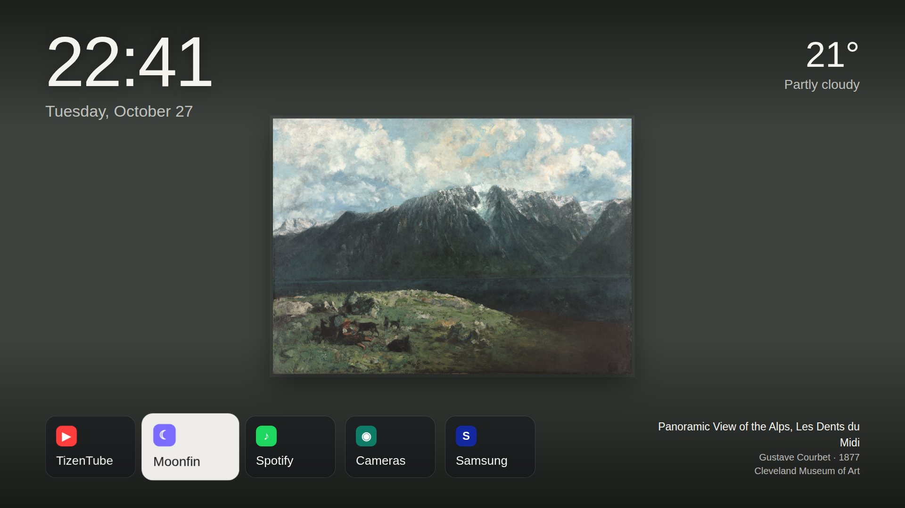
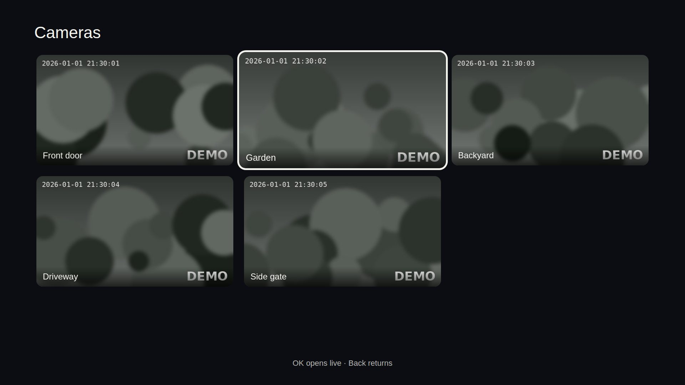
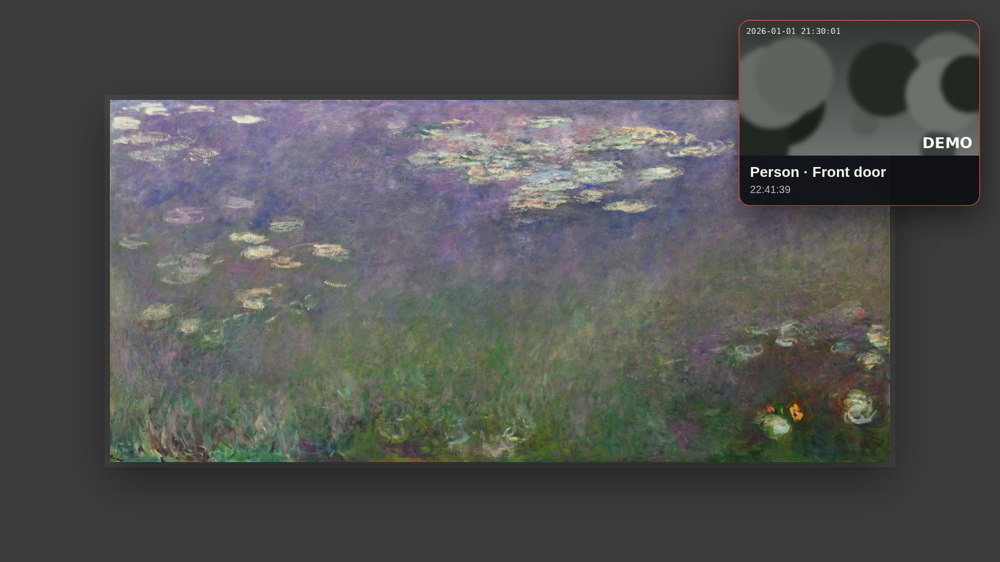

# Art Home — a gallery home screen for Samsung Tizen TVs

**Art Home** turns a Samsung Tizen TV into a quiet picture frame: public-domain paintings fill the
screen, a clock and the weather sit on top, and a small row of apps is one click away. When nobody
touches the remote, the interface fades and only the artwork remains. It also shows your security
cameras and pops up a card when someone walks past one.

It is built **on top of [AeroTizen](https://github.com/helalaou/AeroTizen)** by Hamza El Alaoui,
which does the hard part: making the remote's **Home** button (and power-on) open a custom launcher
on Tizen 9 TVs, with a backup and a clean way back. Art Home replaces AeroTizen's interface with its
own and keeps AeroTizen's Home service untouched.

| Home | Frame mode |
|---|---|
|  |  |
| **Cameras** | **Detection pop-up** |
|  |  |

*Screenshots are rendered at 1920×1080 from the demo mode: camera images are synthetic placeholders.
Paintings: Gustave Courbet and Claude Monet, Cleveland Museum of Art, CC0.*

---

## What Art Home adds to AeroTizen

- **An art library that costs nothing.** `curate_art.py` builds a collection from the
  [Cleveland Museum of Art Open Access](https://openaccess-api.clevelandart.org/) API — only works the
  museum dedicates as **CC0** — picks landscape-friendly paintings, resizes them to 2560 px and
  stores their average colour. The TV loads them from your own server, so a flaky internet
  connection never leaves the wall blank. Every artwork is credited on screen (title, artist, year,
  museum), even though CC0 doesn't require it.
- **Matted, never cropped.** A painting that isn't close to 16:9 is shown on a mat in its own average
  colour, like a framed print, instead of being cut to fill the screen.
- **Frame mode.** After 20 seconds without input the clock, weather and apps fade out and the
  artwork steps forward. The first key only wakes the screen; it never triggers an action.
- **Cameras.** A grid with the latest frame of each camera from [Frigate](https://frigate.video)
  (served from memory, ~30 ms each), refreshed every 1.5 s without flicker, and **live video full
  screen** from [go2rtc](https://github.com/AlexxIT/go2rtc) with OK. Left/right switch cameras;
  heavy H.265 main streams fall back to the light sub stream automatically.
- **Detection pop-ups.** The server follows Frigate's events and the TV shows a card in the top-right
  corner — photo, what was detected, which camera, when — with its own rules (labels, minimum score,
  one card per camera per minute). The **red** button opens that camera live.
- **Energy saving.** No input for 30 min → the artwork slowly dims; at night frame mode is darker;
  optionally, after 2 h idle at night the TV asks the server to turn it off via Home Assistant (the
  server checks the time window and decides — the TV only asks). On Mini-LED/Neo QLED and OLED
  panels a darker picture really draws less power.
- **Arrival mode.** The page only loads from scratch when the TV powers on, so it starts dim in
  frame mode: whoever walks into the room sees the artwork and the camera pop-ups without the TV
  lighting up fully. Any key brings full brightness.
- **Weather** from any Home Assistant `weather.*` entity, no extra API key.
- **English and Brazilian Portuguese** (`"locale": "en"` or `"pt-BR"`); adding a language is one
  block in `launcher/i18n.js`.
- **Changes without reinstalling.** Artworks, app row, cameras, alert and energy settings all come
  from the server's `config.json`; the TV re-reads it every 10 minutes.

What stays **AeroTizen's, unchanged** in the package: `service/` (the background Home service on the
TV, port 47790) and `js/homewatch.js` (its client), plus the native Home assignment done by the
AeroTizen CLI.

## How it fits together

```
 phone / remote                     your server (any always-on Linux box, Docker or plain Python)
      │                               server.py  ── artworks (art/), config.json, weather ← Home Assistant
      ▼                                   ▲          detection alerts ← Frigate /api/events
 Samsung TV ── Art Home package ──────────┘          turn-off request → Home Assistant
   ├─ our screen: launcher/ (art, clock, apps, cameras, pop-ups, energy)
   ├─ AeroTizen service (unchanged): brings Home back to Art Home
   └─ camera images/video straight from Frigate and go2rtc
```

## Requirements

- A Samsung TV with Tizen (tested: 2024 QN85D Neo QLED, **Tizen 9.0**, armv7) in **Developer Mode**.
- The **AeroTizen CLI** (≥ 2.4.0) and a Samsung signing certificate — see AeroTizen's README.
- An always-on machine on the same LAN for `server/server.py` (Python 3.10+, standard library only;
  `curate_art.py` needs Pillow).
- Optional: Home Assistant (weather, turning the TV off), Frigate + go2rtc (cameras and pop-ups).

## Setup

```sh
# 1. the server
cp art-home/config.example.json art-home/config.json       # edit IPs, apps, cameras, locale
cd art-home/server
pip install pillow && python3 curate_art.py --target 60    # builds art/ (CC0 only)
ART_HOME_CONFIG=../config.json HA_TOKEN=... python3 server.py
#    (or: docker compose -f ../docker-compose.example.yml up -d)

# 2. the TV package
cd .. && ./build.sh config.json                             # → dist/package/ and dist/ArtHome.wgt
aerotizen --tv TV_IP install dist/package                   # signs and installs

# 3. make Home (and power-on) open Art Home — AeroTizen's native Home
aerotizen --tv TV_IP home status
aerotizen --tv TV_IP home backup                            # keep this folder: restore uses it
aerotizen --tv TV_IP home apply --yes                       # Home only…
#    …or --boot as well, so turning the TV on opens Art Home instead of live TV:
#    aerotizen --tv TV_IP home restore --yes && aerotizen --tv TV_IP home apply --boot --yes
#    then unplug the TV for 60 s (turning it off with the remote is not enough)
```

Preview the screen in a desktop browser at `http://SERVER:8895/app/index.html` (arrow keys, Enter,
Esc). Set `"demo": true` to see placeholder cameras without a Frigate.

**Undo everything:** `aerotizen --tv TV_IP home restore --yes`, unplug for 60 s, then uninstall the
package. Your TV goes back to Samsung Home exactly as the backup recorded it.

## Lessons from one TV (read before debugging)

These cost us an evening each; they may save you one.

- **Blocking `samsungqbe.com` in your DNS breaks app launches.** It is tempting to block it to hide
  home-screen banners, but it also serves app authentication (`osb-auth-*`) and the app catalog
  (`osb-apps-*`). With it blocked, YouTube and TizenTube froze on a grey screen. Unblock it and
  unplug the TV.
- **`vconftool set` over `sdb shell` does not persist on Tizen 9.** The shell accepts it and returns
  0, but nothing changes (it can't even read values back). That is why AeroTizen's native helpers
  exist — use them.
- **AeroTizen's transport makes the TV connect *back* to your computer** on a random port. A host
  firewall (ufw's default `deny incoming`) silently drops that connection and the CLI reports
  "SDK query transport failed". Allow the TV's IP while you run `home status/backup/apply/restore`,
  then remove the rule.
- **One `sdb` client at a time.** Mixing the official `sdb`, Apps2Samsung and the AeroTizen CLI
  confused the TV; after a failed session it also refused new handshakes for a few minutes.
- **Some apps never report themselves as visible** (YouTube/TizenTube, Prime Video, Spotify), so a
  watcher alone can't tell that Home was pressed inside them. AeroTizen's native Home solves it.
- **Run the server in your timezone.** The night window for turning the TV off uses the server's
  clock; a `python:slim` container is UTC unless you mount `/etc/localtime`. Test the turn-off
  endpoint only with `dry_run=1`.

## Limitations

- Tizen web apps can't draw over other apps: pop-ups appear only while Art Home is on screen (home,
  frame mode, cameras). Inside YouTube or Netflix, rely on your phone notifications.
- There is no public API for the TV's own presence/motion sensors, so "arrival" means "the TV was
  just powered on" — by you, by the TV's own motion setting if your model has one, or by Home
  Assistant reacting to a presence sensor.
- With `--boot`, some TVs show a black screen for a while before the launcher appears (AeroTizen
  documents ~30 s on a Frame).
- Tested on one TV. Other models and firmware may differ — please report what you find.

## Credits and license

- **[AeroTizen](https://github.com/helalaou/AeroTizen)** © 2026 Hamza El Alaoui, MIT — the native
  Home assignment, the TV-side service and `homewatch.js`, used unchanged. Thank you.
- Artworks: **Cleveland Museum of Art Open Access**, CC0. Downloaded by your own server; not
  redistributed in this repository.
- Cameras: [Frigate](https://frigate.video) and [go2rtc](https://github.com/AlexxIT/go2rtc).
- Art Home code: MIT, like AeroTizen. Not affiliated with Samsung. Developer Mode and native Home
  changes are at your own risk; keep AeroTizen's backup folder.
